<div align="center">


# WeVai

**An agent skill that turns your AI coding agent into a motion designer.**<br>
Openers, promos, product demos, kinetic typography, and explainers — built as a single `index.html` that plays like video, not like slides.

[](CHANGELOG.md)
[](LICENSE)
[](#install)
[](#install)

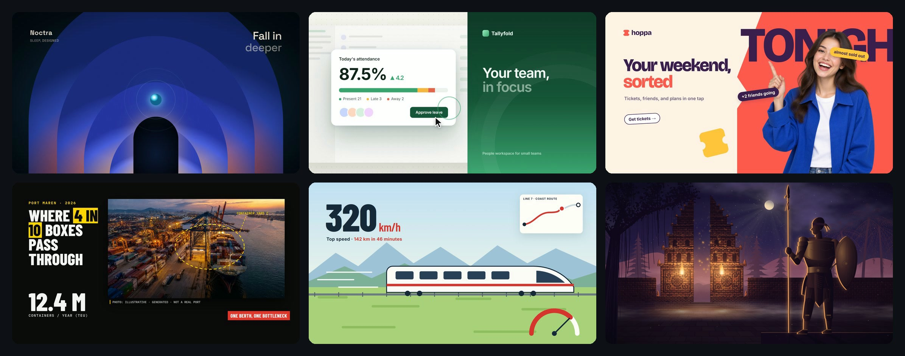

[What you can make](#what-you-can-make) · [Style gallery](#style-gallery) · [Workflow](#recommended-workflow) · [Example prompts](#example-prompts) · [Install](#install) · [FAQ](#faq)

</div>

---

## Why

Ask an AI agent for "a video" and you usually get **slides**: one section per idea, a title, a photo, a fade between them. WeVai encodes what a working motion designer insists on — one continuous world, a camera that actually moves, a subject that persists, text that lives inside the scene — as **rules an agent can check in its own code**, plus starters that make the right architecture the easy path.

It also stops every project from looking the same. The look is **derived from your brand** through a required style brief, the structure is **chosen from a menu of concepts**, and nothing is inherited from the starter or copied from a reference.

## What you can make

| | Output | Typical length |
|---|---|---|
| 🎬 **Openers & promos** | product launches, app promos, campaign spots, teasers | 15–40 s |
| 🖥️ **Product & SaaS demos** | UI assembled and used on screen, camera following the clicks | 20–60 s |
| 🔤 **Kinetic typography** | lyric-style statements, event announcements, manifestos | 10–30 s |
| 📺 **Bumpers, idents, channel intros** | short brand moments that loop | 3–10 s |
| 🧭 **Explainers** | six explainer styles, optional voice-over sync, 16:9 or 9:16 | 30–120 s |
| 🧊 **3D explainers & hero shots** | a Three.js world with a cinematic camera — shot sizes, angles, dolly/crane/rail, lenses, rack focus, lighting presets | 30–90 s |
| 🎥 **Video layers** | your own or generated clips placed like footage — inside devices, frames, and masks, locked to the timeline | — |
| 🎞️ **After Effects builds** | cartoon explainers built directly inside AE through the Higgsfield MCP bridge | — |

Every deliverable is one `index.html`: double-click to play, autoplay + loop, `?debug=1` for a scrub bar, and an optional frame-by-frame export to MP4.

## Style gallery

> Each frame below is a **single static scene** built for this README with **fictional brands and data**. The portrait, product photos, port photo, engraving, and cartoon cutouts were generated with GPT Image 2.5; everything else is HTML, CSS, and SVG. Real projects take their palette, type, and imagery from your brand. The exception is the cinematic night scene: a frame rendered straight from the default scene of `assets/starter-sinematik.html`, 100% code (SVG, Canvas, WebGL) with no images at all.

<table>
<tr>
<td colspan="2">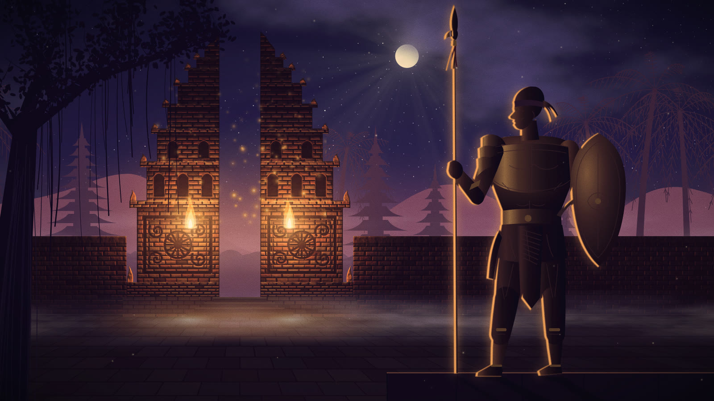<br><b>Cinematic silhouette</b> · history explainer, 100% code<br><sub>Torches that flicker and light what is near them, rim-lit silhouettes, layered fog, embers, one color grade. Built from the <code>atmosfer</code>, <code>cahaya-2d</code>, and <code>pasca</code> modules (1.3.0). Default scene of the <code>starter-sinematik.html</code> starter. History, culture, documentaries.</sub></td>
</tr>
<tr>
<td width="50%">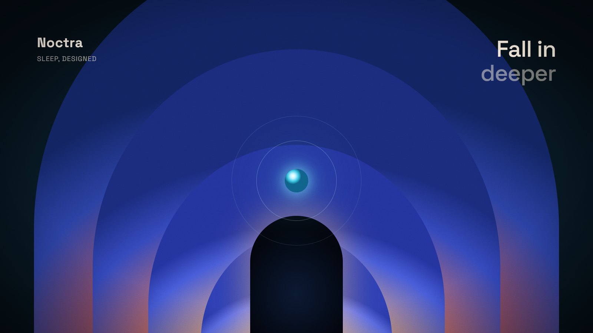<br><b>Grainy gradient</b> · opener<br><sub>Glowing layered shapes, soft grain, a camera that travels through them. Tech, AI, music, premium launches.</sub></td>
<td width="50%">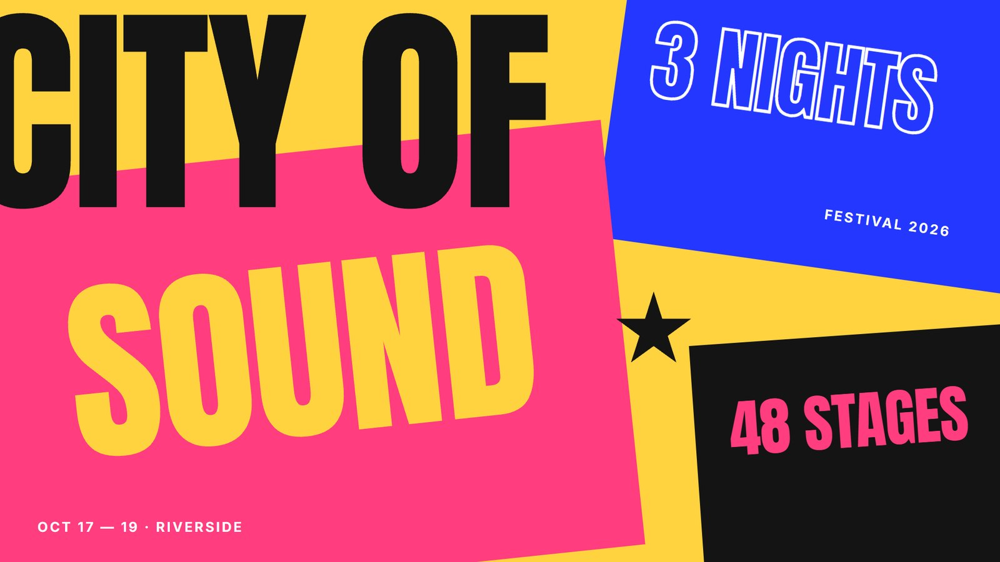<br><b>Poster color-block</b> · kinetic typography<br><sub>Huge cropped words, solid color fields that slam in on the beat. Events, music, launches.</sub></td>
</tr>
<tr>
<td>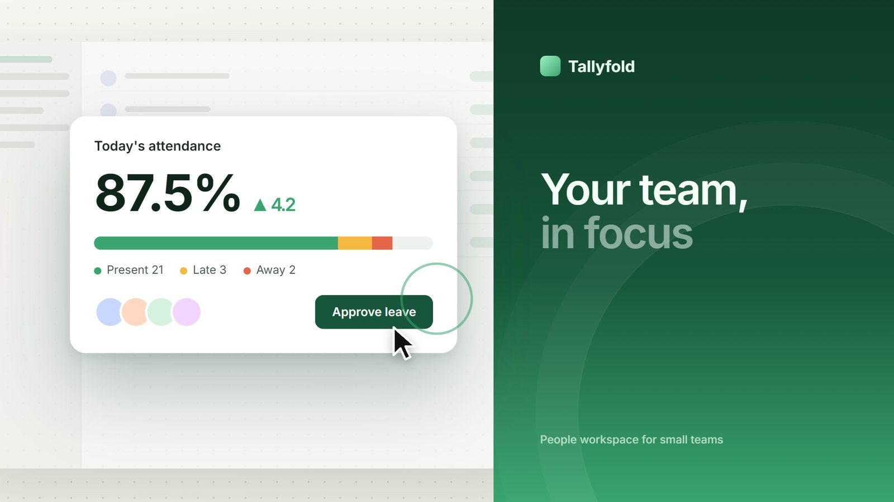<br><b>Product tour with claims</b> · SaaS demo<br><sub>Real UI lifted out of the dashboard, the camera zooms into what gets clicked. SaaS, dashboards, B2B.</sub></td>
<td>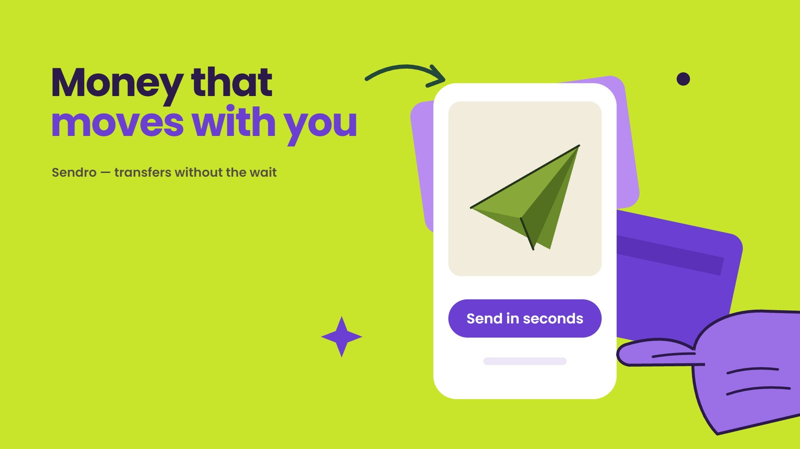<br><b>Flat vector illustration</b> · promo<br><sub>Solid fills, stylized hands, UI drawn flat, shapes with gentle overshoot. Fintech, consumer apps.</sub></td>
</tr>
<tr>
<td>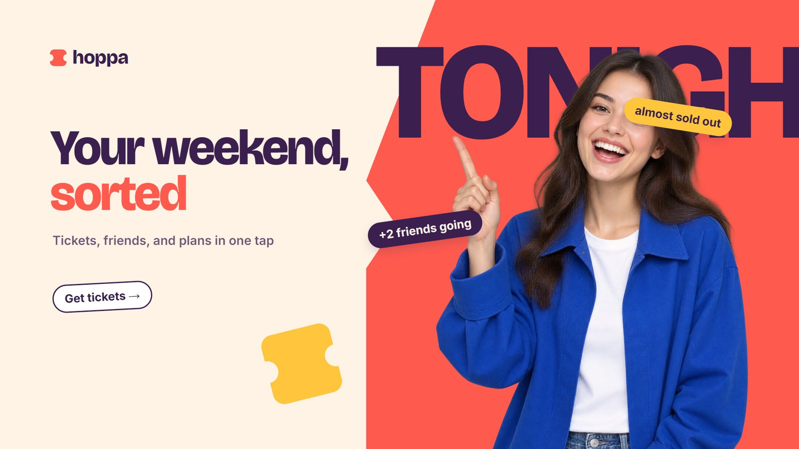<br><b>Flat pop with photos</b> · promo<br><sub>Photo cutouts popping in, stickers, brand color fields that change with a visible trigger. Consumer apps, campaigns.</sub></td>
<td>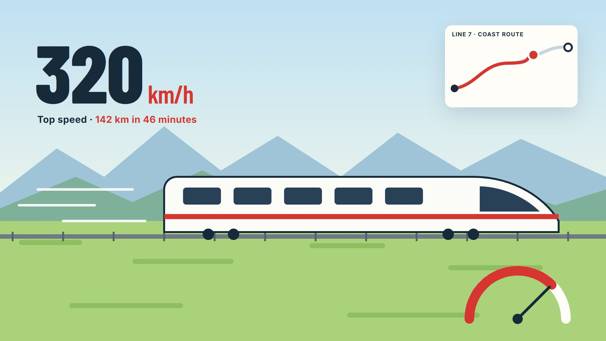<br><b>Continuous action</b> · explainer<br><sub>One subject that never stops, numbers and maps living inside the world. Speed, routes, processes.</sub></td>
</tr>
<tr>
<td>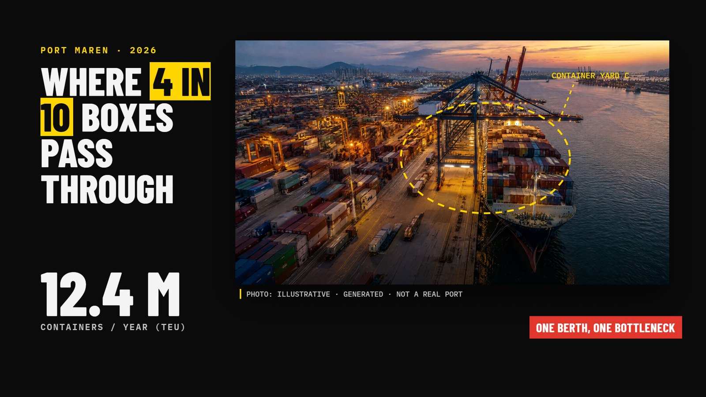<br><b>Visual journalism</b> · explainer<br><sub>Black ground, real photos with source tags, highlighter, dashed annotations. News, current issues.</sub></td>
<td>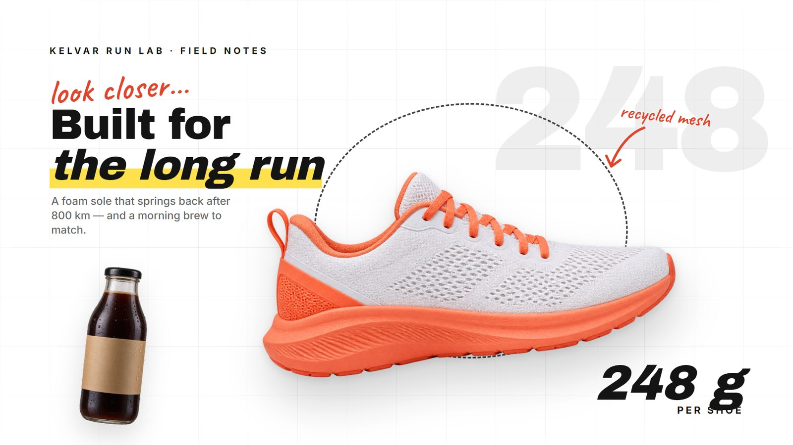<br><b>White catalog</b> · explainer<br><sub>White grid, product cutouts, mixed script and heavy sans. Products, brands.</sub></td>
</tr>
<tr>
<td>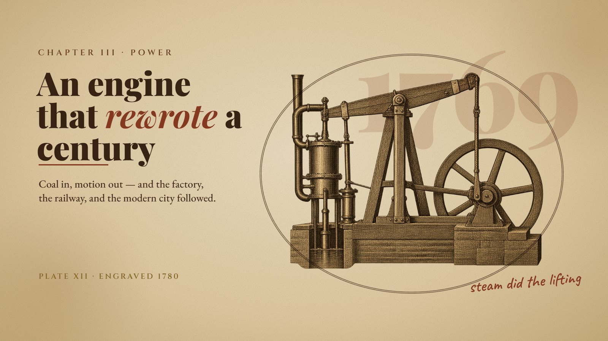<br><b>Vintage sketch</b> · explainer<br><sub>Sepia paper, engraving art, classic serifs, rust notes. History, biography.</sub></td>
<td>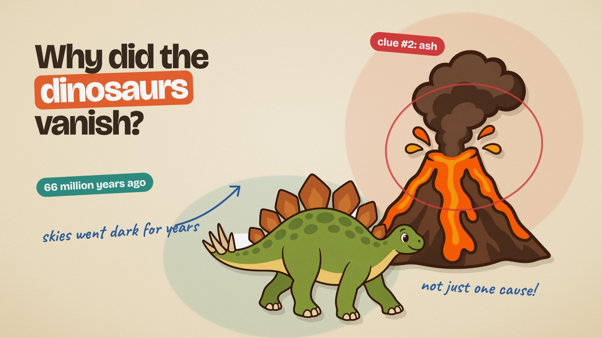<br><b>Cartoon collage</b> · explainer<br><sub>Cream paper, flat illustration cutouts, color pills, handwriting. Science, education.</sub></td>
</tr>
<tr>
<td><br><b>Cartoon stage</b> · explainer<br><sub>One living stage per scene, jointed characters, no captions. Education with characters.</sub></td>
<td>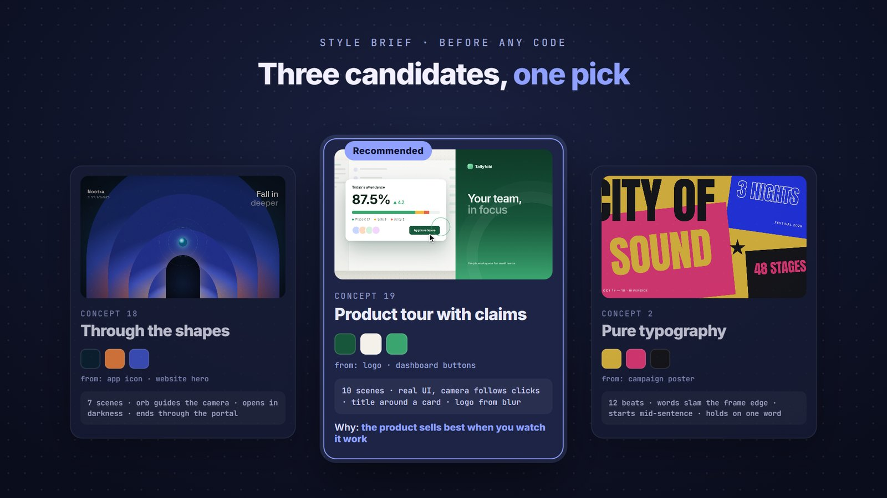<br><b>…and many more</b><br><sub>10 styles × 19 concepts × 9 render families — three candidates, one pick.</sub></td>
</tr>
</table>

### Cinematic history styles, 100% code

Every frame below is rendered straight from a starter's default scene: SVG, Canvas, and WebGL, with no generated images and no photos. Sample content is about Javanese and Balinese history; scenes are stylized illustrations, not reconstructions of specific monuments.

<table>
<tr>
<td colspan="2"><br><b>Multi-scene act</b><br><sub>Five scenes, one eagle-eye flight through the gate, a rigged character. <code>assets/starter-babak.html</code></sub></td>
</tr>
<tr>
<td width="50%">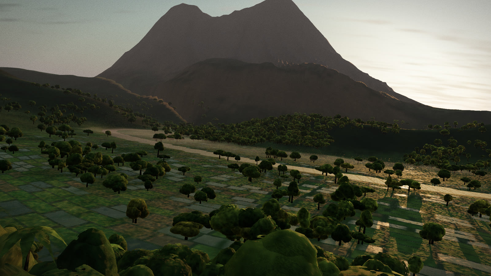<br><b>Eagle-eye 3D</b><br><sub>Procedural landscape, flight path with banking, film tone mapping. <code>assets/starter-elang.html</code></sub></td>
<td width="50%">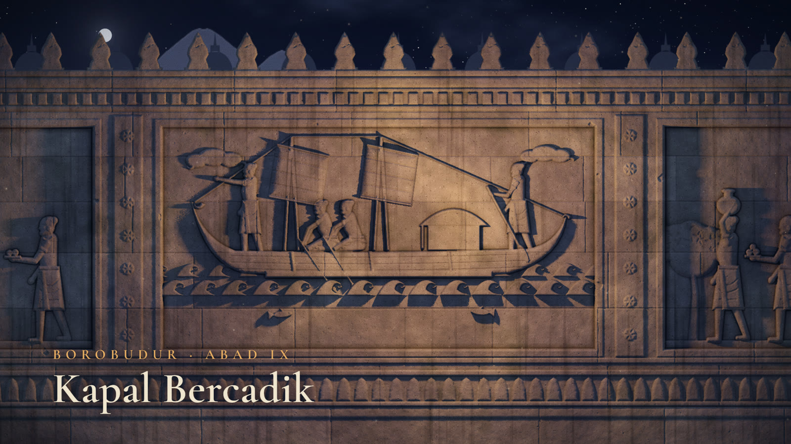<br><b>Living temple relief</b><br><sub>Carved stone, torchlight whose shadows move, figures that stir. <code>assets/starter-relief.html</code></sub></td>
</tr>
<tr>
<td>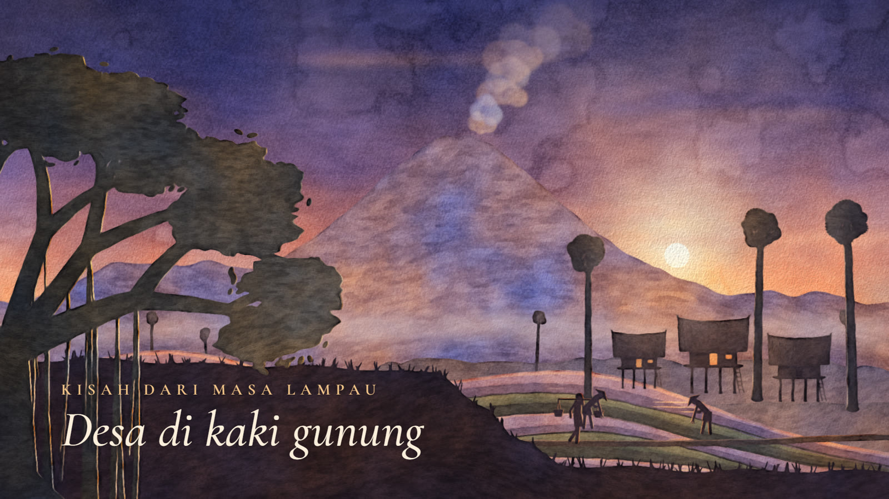<br><b>Painterly legend</b><br><sub>Kuwahara and watercolor, each plane painted once so strokes never boil. <code>assets/starter-lukis.html</code></sub></td>
<td>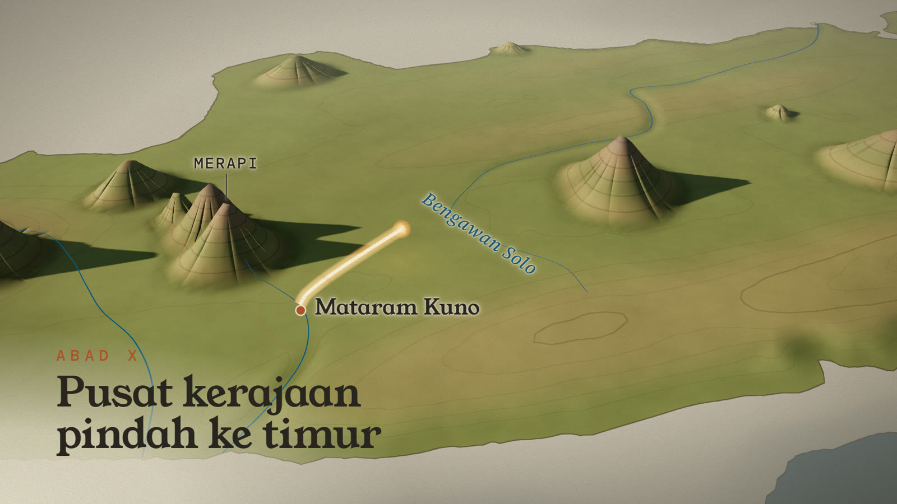<br><b>3D relief map</b><br><sub>Real coastline and volcanoes, a route that draws on, labels pinned to the map. <code>assets/starter-peta-relief.html</code></sub></td>
</tr>
<tr>
<td>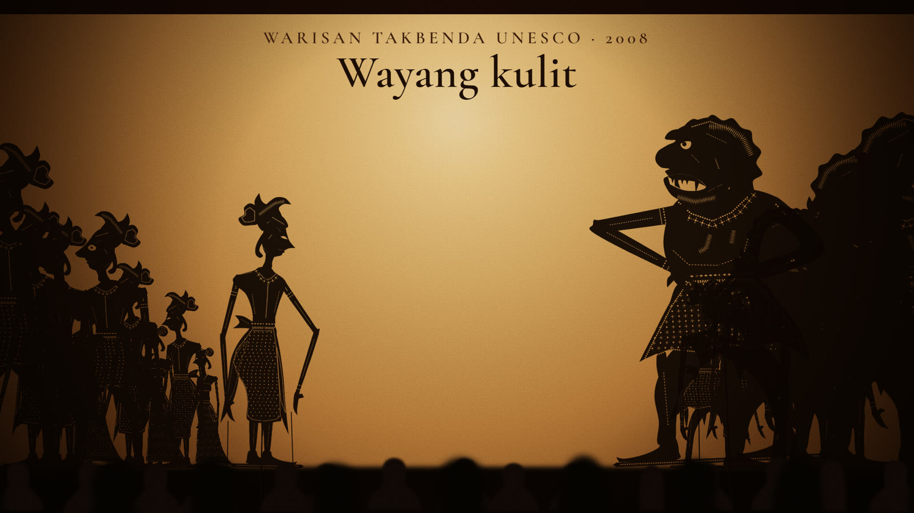<br><b>Wayang kulit</b><br><sub>Perforated puppets, flickering lamp, shadows that blur with distance to the screen. <code>assets/starter-wayang.html</code></sub></td>
<td>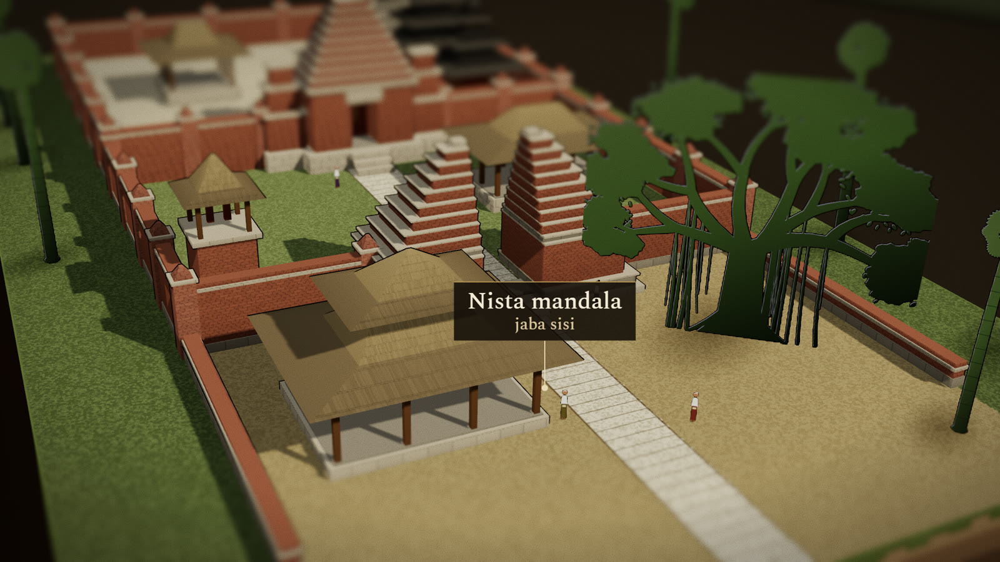<br><b>Cel-shaded diorama</b><br><sub>Toon shading, ink outlines, tilt-shift, to explain how a place is laid out. <code>assets/starter-diorama.html</code></sub></td>
</tr>
</table>

## The menus behind the looks

<details>
<summary><b>10 style directions</b> — the skin, derived from your brand</summary>

| Direction | Background | Typography | Signature motion | Good for |
|---|---|---|---|---|
| Cinematic dark | near-black gradient, particles, bloom only on objects | bold clean grotesk | push-through, light in front of the lens | creative tools, gaming, tech |
| Poster color-block | large solid color fields changing per scene | ultra-heavy display, giant cropped letters | block wipes, text slamming the frame edge | consumer apps, music, events |
| Editorial light | white/cream, generous space, hairlines | display serif + small grotesk | calm slides, lines that draw | productivity, finance, SaaS |
| Paper & print | paper texture, collage, stamps, tape | handwriting + serif | objects flying in and landing | education, community, food |
| Retro / analog | faded color, grain, scanlines | 70s–90s geometric | controlled glitch, rough zoom, freeze | nostalgia, music, entertainment |
| Brutalist mono | black and white, hard grid | monospace + condensed | hard cuts, shifting blocks, blinking cursor | developer tools |
| Pastel playful | stacked pastels, big round shapes | heavy rounded sans | elastic bounce, blooming shapes | kids, health, lifestyle |
| Luxury dark | black + gold/bronze, soft shadows | tall wide-tracked serif | slow motion, sweeping light, depth | fashion, automotive, property |
| Flat pop with photos | neutral light alternating with solid brand fields | rounded heavy sans + giant cropped words | cutouts popping in, stickers, fields snapping on the beat | consumer apps, fintech, e-commerce |
| Grainy gradient | deep base, saturated glowing shapes, fine grain | small clean grotesk or minimal heavy display | layers opening, camera through the shape, a guiding orb | tech, AI, music, creative launches |

</details>

<details>
<summary><b>19 opener concepts</b> — the structure, chosen per product</summary>

| # | Concept | Good for |
|---|---|---|
| 1 | One continuous shot | creative tools, hardware, spaces |
| 2 | Pure typography | strong taglines, events, releases |
| 3 | Problem → gone | productivity, utilities |
| 4 | Before / after | editors, filters, optimization |
| 5 | Journey inside the UI | apps with a distinctive UI |
| 6 | Product macro | hardware, packaging, F&B, fashion |
| 7 | Object metaphor | security, cloud, finance |
| 8 | Living number | milestones, performance |
| 9 | One feature, fully demoed | apps with one clear edge |
| 10 | Diegetic question → answer | AI, search, support |
| 11 | Rhythmic collage | music, lifestyle, community |
| 12 | Logo as stage | brands with a strong logo shape |
| 13 | Object relay | e-commerce, delivery, marketplaces |
| 14 | Brand system showcase | launches, rebrands, communities |
| 15 | Claim → how → result | new features, generative AI, creative tools |
| 16 | Living UI ecosystem | B2B SaaS, AI assistants, workflows |
| 17 | Flat pop with photos | consumer apps, fintech, campaigns |
| 18 | Through the gradient shapes | tech, AI, security, premium launches |
| 19 | Product tour with claims | SaaS, team tools, dashboards |

Each concept ships as principles and a menu of openings, transitions, and endings — never as a script to copy.

</details>

<details>
<summary><b>6 explainer styles</b> — each with its own starter</summary>

| Style | Look | Best for |
|---|---|---|
| Continuous action | flowing vector world, one subject that never leaves, changing viewpoints | speed, routes, processes |
| Cartoon collage | cream paper, flat illustration cutouts, handwriting, color pills | science, education |
| Visual journalism | black, real photos with source tags, highlighter, dashed annotations | news, current issues |
| White catalog | white grid, photo cutouts, mixed typography, scribbles | products, brands |
| Vintage sketch | sepia paper, engraving art, classic serifs, rust annotations | history, biography |
| Cartoon stage | one stage per scene, jointed characters, no captions | education with characters |

</details>

## Recommended workflow

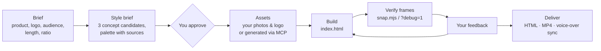

1. **Brief the agent.** Name the product, attach the logo or site, say who it is for, the length, and the ratio. Mention a style if you have one in mind — the name is enough.
2. **Approve the style brief.** The agent answers with three concept candidates, one recommendation, a structure fingerprint, and a palette where every color states its source. Change anything before a line of code is written.
3. **Settle the assets.** Your own photos and logo come first. If you have none, the agent can generate them through an image MCP (fictional faces, logos added in code) — or pick a concept that needs no photos.
4. **Let it build.** You get one `index.html`. The agent captures key seconds and checks them against the rules before handing over.
5. **Review and iterate.** Open it, scrub with `?debug=1`, and describe what feels off. Feedback lands on the same file.
6. **Deliver.** Keep the HTML, export MP4 with `scripts/export-frames.mjs`, or send a voice-over and the timeline re-times itself to it.

> **Tip:** start each new video in a **new chat**. The skill is read when it is first invoked, and a long chat keeps earlier decisions in context.

## Example prompts

```text
Make a 30-second opener for my note-taking app. Logo and screenshots attached.
```
```text
Build a 45-second product tour of our HR dashboard in the "product tour with claims" style, 16:9.
```
```text
Promo for a ticketing app in the flat pop with photos style — generate fictional people, 9:16, 20 seconds.
```
```text
Kinetic typography for our festival announcement: "City of Sound, 3 nights, 48 stages". Loud, color-block.
```
```text
Explain how a container port works in 60 seconds, visual journalism style, no voice-over.
```
```text
Promo for our editing app with a screen recording playing inside a laptop mockup, 30 seconds. Clip attached.
```
```text
A cartoon explainer on why volcanoes erupt, for kids, 9:16, I will send a voice-over later.
```

**Getting better results**

- Say *which style*, not *which scenes*. "Grainy gradient" gives you the look; listing a reference's scenes gives you a copy.
- Hand over real brand material — logo, site, app screenshots, photos. The palette and shapes are derived from it.
- Want one specific moment? Ask for it explicitly; otherwise the agent composes new ones.
- Keep text short. Openers carry one feeling, explainers one argument.

## Install

WeVai follows the open **Agent Skills** layout: a folder with `SKILL.md` (frontmatter + instructions), `references/`, `assets/`, `scripts/`. It also ships as a Claude Code **plugin**.

### As a plugin (Claude Code)

```
/plugin marketplace add aammuhammad18-cmyk/wevai
```
```
/plugin install wevai@wevai
```

Update later with `/plugin marketplace update wevai`.

### Manual (any agent)

```bash
git clone https://github.com/aammuhammad18-cmyk/wevai
```

| Agent | Where it goes |
|---|---|
| Claude Code | `~/.claude/skills/wevai` (Windows: `C:\Users\<you>\.claude\skills\wevai`) |
| Codex CLI | your Codex skills folder, or add to `AGENTS.md`: *"For motion graphics / explainers, read and follow `wevai/SKILL.md`."* |
| Google Antigravity | `~/.gemini/config/skills/wevai` (Windows: `%USERPROFILE%\.gemini\config\skills\wevai`) — see [Google Antigravity](#google-antigravity) |
| Gemini CLI · Cursor · others | copy into the project and reference `SKILL.md` from `GEMINI.md`, `.cursor/rules`, or the system prompt |
| Plain chat (no agent) | paste `SKILL.md` + the relevant file in `references/` as instructions; attach a starter from `assets/` |

> Install **one copy** only. A plugin copy and a manual folder copy do not replace each other — plugin skills are namespaced (`wevai:wevai`), so both stay active and the agent may load the rules twice.

The skill triggers on requests like "make an opener…", "promo video…", "explainer…", or a complaint that a web animation "looks like PowerPoint".

### Google Antigravity

Antigravity reads the Agent Skills layout natively, so WeVai is one folder in its global skills directory. The same folder serves the Antigravity App, CLI, and IDE. The folder **must be named `wevai`** (a zip download unpacks as `wevai-main`; rename it).

As an Antigravity plugin (the repo ships `.antigravity-plugin/plugin.json`, which passes `agy plugin validate --strict`; the install itself is not yet field-tested, so the manual route below is the dependable one):

```
agy plugin install https://github.com/aammuhammad18-cmyk/wevai
```

Manual install. Windows (PowerShell), skills folder `%USERPROFILE%\.gemini\config\skills\wevai`:

```powershell
git clone https://github.com/aammuhammad18-cmyk/wevai "$env:USERPROFILE\.gemini\config\skills\wevai"
npm install --prefix "$env:USERPROFILE\.gemini\config\skills\wevai\scripts"
```

macOS / Linux, skills folder `~/.gemini/config/skills/wevai`:

```bash
git clone https://github.com/aammuhammad18-cmyk/wevai ~/.gemini/config/skills/wevai
npm install --prefix ~/.gemini/config/skills/wevai/scripts
```

`npm install` is optional: Node + puppeteer only power the frame checks and MP4 export (see [Requirements](#requirements)), and a Chrome or Edge you already have is found automatically, with no environment variable to set. Update later with `git -C <that folder> pull`.

Already have a checkout elsewhere? Don't link it with a Windows junction: Antigravity skipped a junctioned skill folder when tested with `agy` 1.5.0. Point `~/.gemini/config/skills.json` at the folder that contains the checkout instead (the checkout must be named `wevai`):

```json
{ "entries": [ { "path": "E:/projects", "include_only": ["wevai"] } ] }
```

Start a new conversation afterwards, then ask the agent whether `wevai` is in its skill list.

If every tool call fails with `Cannot find module` and a path cut off at a space (for example `..."C:\Users\IT'`), the `PreToolUse` hook of the `googlecloudtools.datacloud_telemetry` plugin is breaking on a Windows user name with a space, and the agent falls back to replying with text only. `agy plugin disable googlecloudtools.datacloud_telemetry` clears it.

Call it with `/wevai` in the App (for example `/wevai make a 20-second opener for a coffee app`), or just ask for an opener, promo, or explainer and let the agent pick the skill.

Image and video generation is optional: register the MCP server you use in `~/.gemini/config/mcp_config.json` (Windows: `%USERPROFILE%\.gemini\config\mcp_config.json`) under `mcpServers`. Higgsfield's endpoint is usually quoted as `https://mcp.higgsfield.ai/mcp`, but that URL is **unverified** (only third-party write-ups give it): confirm it in Higgsfield's own docs first.

## Requirements

| To… | You need |
|---|---|
| **Watch** the result | a browser + internet (GSAP and fonts load from a CDN). Nothing else. |
| Verify frames automatically | Node + puppeteer (`scripts/snap.mjs`) — optional; `?debug=1` works by hand. Run `npm install --prefix "<skill folder>/scripts"` once (any shell, any folder), then run the scripts from your project folder. An installed Chrome or Edge is found automatically; `PUPPETEER_EXECUTABLE_PATH` is only for unusual install locations |
| Export MP4 | Node + puppeteer + ffmpeg (`scripts/export-frames.mjs`, 16:9 or 9:16, voice-over muxed) — optional |
| Sync to voice-over | ffmpeg, **or** nothing: `scripts/vo-pauses.html` detects pauses in the browser |
| Generate a voice-over | optional: Node ≥ 18 + a Gemini API key for `scripts/vo-gemini.mjs` ([details below](#voice-over-with-gemini-optional)); or bring your own recording |
| Keep an offline archive copy | `scripts/vendor-libs.mjs` — inlines GSAP and the fonts (WebGL openers still need the CDN) |
| Use video clips | MP4 (H.264) or WebM files in `assets/` — optional |
| Generate images | any image MCP the agent can call — optional |
| Build in After Effects | After Effects + the Higgsfield MCP bridge — optional |

A deliverable never needs `npm install` to be watched.

### Voice-over with Gemini (optional)

`scripts/vo-gemini.mjs` turns a JSON script into voice-over files with the official Gemini text-to-speech API (Node ≥ 18, zero dependencies). Each segment gets `<id>.wav` (24 kHz mono 16-bit) and `<id>.json` with the **exact** duration computed from the sample count; re-running resumes where it stopped.

```bash
node scripts/vo-gemini.mjs script.json --keluar audio/vo --suara Kore
node scripts/vo-gemini.mjs --cek-kunci        # check your keys (uses no TTS quota)
node scripts/vo-gemini.mjs --daftar-suara     # list voices, including regional accents
```

It accepts up to **10 API keys** (env `GEMINI_API_KEYS` / `GEMINI_API_KEY`, or a key file *outside* any repo: `~/.wevai/gemini-kunci.txt`, one key per line) and fails over on its own: when a key hits a per-minute or daily limit, is invalid, or errors, it moves to the next key, paces itself to the limit it is told about, and picks up again after the daily reset (midnight Pacific). The tool never prints a key in full or writes one anywhere (its state file keeps only a hash), and you should never commit them.

> **Read this before adding keys.** Gemini API quotas are applied **per Google Cloud project, not per API key** — keys from the same project share one quota, so extra keys from one project add nothing. The Google APIs Terms of Service (§2(d)) say you "will not attempt to circumvent" the limits documented with each API. Use only keys you are entitled to use — for example projects that belong to different team members, or a paid key as a backup. Creating projects or accounts just to multiply free quota risks account suspension. This tool is for resilience, **not** for extra quota. See the [Google APIs Terms](https://developers.google.com/terms) and the [Gemini rate limits](https://ai.google.dev/gemini-api/docs/rate-limits). Full usage notes: `references/alat-kerja.md` › "VO Gemini (banyak kunci)" (in Indonesian).

## How the rules work

- **Style brief before code** — concept, structure fingerprint, palette with sources, display font, background surface and motion, render family, transitions, one special moment.
- **Structure from a menu** — three concept candidates per project, at most two "canonical" components, and a different fingerprint from the previous video.
- **Examples are principles, not scripts** — openings and endings differ from the concept's example, signature moments are transformed, and the example's colors and shapes never carry over.
- **Living typography** — sentence case, emphasis by order, size, or pause; word highlights and punctuation only when they add meaning.
- **A background that never sits still** — a chosen background motion, and color changes with a visible trigger.
- **Video as footage layers** — clips follow the timeline clock, so scrubbing and MP4 export stay frame-accurate.
- **A camera that works** — breathing drift, motivated push-throughs, and in UI demos a camera that follows the important clicks.
- **Structural anti-slide checks** — no fading sections, a persistent subject or world, at most two text levels, varied transitions with real depth.
- **Readable on phones** — no text under 30 px on a 1080-wide stage.

Full detail lives in `SKILL.md` and `references/`.

## Repository layout

```
SKILL.md                         rules & workflow (read by the agent)
.claude-plugin/                  plugin + marketplace manifests
references/
  opener-konsep.md               19 opener concepts, UI animation, photos in openers
  anti-ppt.md                    slide patterns → fixes, structural bans checked from code
  checklist.md                   pre-delivery checklist + known traps
  aset-mcp.md                    generating assets through MCP (capability, not vendor)
  isi-paket.md                   full list of the package's files
  techniques.md                  typography, camera, transitions, backgrounds, render families
  sinematografi.md               cinematic camera & lighting vocabulary, 2.5D vs 3D, 3D pitfalls
  explainer.md                   explainer styles, camera recipes, VO re-timing
  kartun-panggung.md             cartoon stage explainers
  diorama.md                     museum-miniature diorama style: API, cost, accuracy + sources for the tri mandala layout
  architecture.md                stage, camera rig, determinism, export
  ae-bridge-higgsfield.md        building inside After Effects via the MCP bridge
  roadmap.md                     where the skill is heading
  peta-relief.md                 3D relief map: Natural Earth coast, GVP volcanoes, glowing route, accuracy limits
assets/
  starter-opener.html            opener / promo architecture (GSAP + Three.js)
  starter-explainer*.html        one starter per explainer style
  starter-explainer-3d.html      3D world explainer (Three.js + shared cinematic camera)
  starter-sinematik.html         cinematic silhouette, one scene, 100% code: torches, rim light, layered fog, one grade
  starter-babak.html             60 s cinematic history act, 100% code: five scenes, three worlds, one 2.5D eagle-eye shot
  katalog-pustaka.html           showcase of the procedural ancient-Java asset library (src/runtime/pustaka.js)
  katalog-tokoh.html             showcase of the character rig v2: archetypes, IK walk, crowd (src/runtime/tokoh.js)
  starter-elang.html             3D eagle-eye establishing shot: procedural landscape, flight path, film tone mapping
  starter-relief.html            living temple relief, 100% code (carved andesite, moving torchlight, figures that move)
  starter-lukis.html             painterly legend scene (Kuwahara + watercolour), each plane painted once, so strokes never boil
  starter-peta-relief.html       3D relief map of Java: printed contour map rises into a lit relief, route lights up
  starter-wayang.html            wayang kulit shadow theatre, 100% code (kelir, flickering blencong, gunungan, shadow blur by distance)
  starter-diorama.html           museum-miniature diorama (toon, ink outlines, tilt-shift) explaining a place's layout: a generic Balinese pura
scripts/
  lint-motion.mjs                check the mechanical rules on a deliverable
  snap.mjs                       verify: capture key seconds
  nilai-visual.mjs               verify by numbers: luminance range ("flat"), subject contrast, glow at declared light sources, dominant colours (tests: test-nilai.mjs)
  export-frames.mjs              export: frame-by-frame → MP4, piped to ffmpeg, 2 parallel workers by default (16:9 or 9:16, voice-over muxed)
  antre-render.mjs               long videos: render chapter by chapter, resumable, fps/ETA log, final concat, built-in sleep prevention
  vo-pauses.html                 voice-over pause detection, no ffmpeg needed
  chrome.mjs                     finds Chrome/Edge for the scripts that open a browser (no env var needed)
  bantuan.mjs                    makes `--help` / `-h` print a script's usage instead of running it
  vo-gemini.mjs                  voice-over from the Gemini TTS API: up to 10 keys with automatic failover, resumable, exact durations
  test-vo.mjs                    tests for vo-gemini.mjs (no network, no keys)
  test-pustaka.mjs               tests for the ancient-Java asset library (no browser)
  test-elang.mjs                 tests for the eagle-eye flight maths (no browser)
  test-relief.mjs                tests for the living-relief engine (no browser)
  test-tokoh.mjs                 tests for the character rig v2 (no browser)
  test-wayang.mjs                tests for wayang kulit (no browser)
  test-ekspor.mjs                tests for antre-render.mjs and the export defaults (no browser, no ffmpeg)
  test-lukis.mjs                 tests for the painterly runtime: knobs, paint queue, pose cycle (no browser)
  test-peta.mjs                  tests for the relief-map terrain and route maths (no browser)
  peta-data.mjs                  rebuild the encoded coastline / 200 m isobath from Natural Earth (maintenance)
  test-diorama.mjs               tests for the diorama runtime: tri mandala layout, tilt-shift band, card placement (no browser)
  serve.py                       no-cache dev server (optional)
  vendor-libs.mjs                inline GSAP + fonts for an offline archive copy
  build-starters.mjs             inline src/runtime into the starters (repo maintenance)
  test-starters.mjs              browser smoke test: loop, OPENER contract, page errors
  bump-version.mjs               set the version everywhere at once
  context-budget.mjs             how much an agent must read per job path
  eval-run.mjs                   score the standard briefs in evals/
  ae/bridge/                     After Effects bridge helpers
src/runtime/                     shared runtime blocks inlined into every starter
evals/briefs/                    standard briefs used to check the rules still help
docs/gallery/                    README preview images
```

## FAQ

<details>
<summary><b>Is the output a video file?</b></summary>

The deliverable is an `index.html` that plays like a video: autoplay, loop, no player chrome. When you need a file, `scripts/export-frames.mjs` renders it frame by frame to MP4.
</details>

<details>
<summary><b>Will every video end up looking the same?</b></summary>

That is the main thing the skill prevents. The palette and shapes come from your brand, the structure comes from a concept chosen for your product, and each project must differ from the previous one in both skin and structure.
</details>

<details>
<summary><b>Can I give it a reference video?</b></summary>

Yes. The agent takes rhythm, energy, and motion language from it — not the palette, fonts, layout, scene order, or signature moments.
</details>

<details>
<summary><b>Do I need photos?</b></summary>

Only for photo-based styles. Use your own, a licensed stock set, or let the agent generate fictional people and props through an image MCP. Otherwise pick an illustrated or typographic style.
</details>

<details>
<summary><b>Can I use video clips?</b></summary>

Yes. Clips become footage layers: trimmed, masked, graded, and animated with the rest of the scene, always in sync with the timeline — including frame-by-frame MP4 export. Use your own footage, licensed stock, or clips generated through a video MCP.
</details>

<details>
<summary><b>Can it build in After Effects?</b></summary>

Yes, for cartoon explainers: with After Effects open and the Higgsfield MCP bridge connected, the agent builds compositions, characters, and keyframes directly in AE.
</details>

## Contributing

The skill's instructions (`SKILL.md`, `references/`) are written in **Indonesian** — that is the source of truth, and PRs that touch rules should stay in Indonesian. README and the marketplace listing are English.

Issues and pull requests are welcome. When you add a rule, describe which failure it prevents and offer it as a menu option rather than a single "right answer".

Before opening a PR (same checks CI runs):

```bash
npm install --prefix scripts            # once
node --test scripts/test-kamera.mjs        # camera core (no browser)
node --test scripts/test-vo.mjs            # voice-over tool (no network, no keys)
node --test scripts/test-nilai.mjs        # visual scoring tool (synthetic PNGs, no browser)
node --test scripts/test-pustaka.mjs       # ancient-Java asset library (no browser)
node --test scripts/test-elang.mjs        # eagle-eye flight maths (no browser)
node --test scripts/test-relief.mjs        # living temple relief engine (no browser)
node --test scripts/test-tokoh.mjs         # character rig v2 (no browser)
node --test scripts/test-wayang.mjs        # wayang kulit (no browser)
node --test scripts/test-ekspor.mjs        # render queue + export defaults (no browser, no ffmpeg)
node --test scripts/test-lukis.mjs        # painterly runtime (no browser)
node --test scripts/test-peta.mjs         # relief-map terrain and route maths (no browser)
node --test scripts/test-diorama.mjs      # diorama runtime (no browser)
node scripts/build-starters.mjs --check   # starters match src/runtime
node scripts/bump-version.mjs --check     # version is the same everywhere
node scripts/lint-motion.mjs assets/*.html
node scripts/test-starters.mjs            # loads every starter in a browser
node scripts/context-budget.mjs --check   # reading load per job path stays within budget
```

Never edit the runtime blocks inside a starter — edit `src/runtime/*.js` and run `node scripts/build-starters.mjs`. Release: `node scripts/bump-version.mjs <version>` plus a `CHANGELOG.md` entry.

## License

[MIT](LICENSE) © 2026 [aammuhammad18](https://github.com/aammuhammad18-cmyk/wevai)
